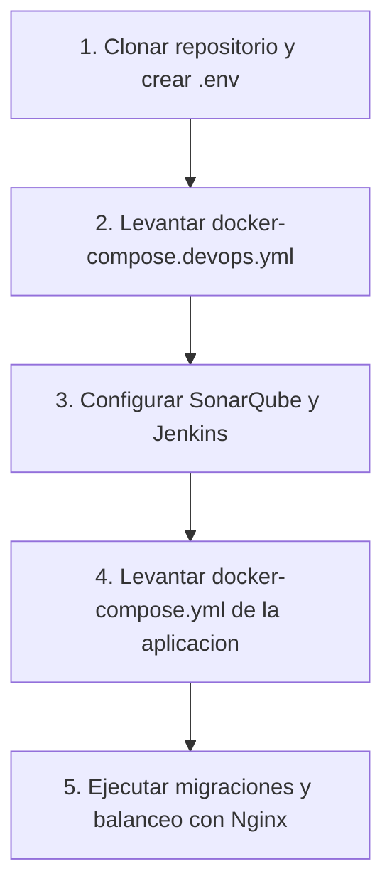

# Riwi Cine Backend (NestJS) — Guia Completa de Integracion CI/CD y Orquestacion Docker

Guia paso a paso para configurar la pipeline de integracion y control de calidad continuo (CI/CD) de **Riwi Cine Backend**, conectando **GitHub / GitLab**, **Jenkins**, **SonarQube** y la orquestacion de contenedores con **Docker Compose** y balanceo de carga en **Nginx**.

> Nota sobre el estado actual: La aplicacion se encuentra preparada y orquestada para su construccion, analisis, ejecucion y pruebas locales o en entornos controlados, pero **aun no cuenta con un despliegue productivo final**. Esta guia detalla como levantar toda la infraestructura desde cero y recrearla limpiamente.

---

## Tabla de Contenidos
1. [Arquitectura y Separacion de Archivos Docker Compose](#1-arquitectura-y-separacion-de-archivos-docker-compose)
2. [Como Recrear Todo el Entorno desde Cero](#2-como-recrear-todo-el-entorno-desde-cero)
3. [Paso 1: Configurar el Proyecto y Token en SonarQube](#3-paso-1-configurar-el-proyecto-y-token-en-sonarqube)
4. [Paso 2: Instalacion de Plugins y Herramientas en Jenkins](#4-paso-2-instalacion-de-plugins-y-herramientas-en-jenkins)
5. [Paso 3: Integrar Jenkins con SonarQube (Credenciales y Servidor)](#5-paso-3-integrar-jenkins-con-sonarqube-credenciales-y-servidor)
6. [Paso 4: Configurar el Webhook de SonarQube hacia Jenkins (Quality Gate)](#6-paso-4-configurar-el-webhook-de-sonarqube-hacia-jenkins-quality-gate)
7. [Paso 5: Conectar el Repositorio Git y Crear el Pipeline en Jenkins](#7-paso-5-conectar-el-repositorio-git-y-crear-el-pipeline-en-jenkins)
8. [Paso 6: Configurar el Webhook del Repositorio hacia Jenkins (Disparo Automatico)](#8-paso-6-configurar-el-webhook-del-repositorio-hacia-jenkins-disparo-automatico)
9. [Paso 7: Ejecucion y Flujo de las 11 Etapas del Pipeline](#9-paso-7-ejecucion-y-flujo-de-las-11-etapas-del-pipeline)
10. [Paso 8: Escalado Dinamico de Replicas y Verificacion](#10-paso-8-escalado-dinamico-de-replicas-y-verificacion)
11. [Solucion de Problemas Frecuentes (Troubleshooting)](#11-solucion-de-problemas-frecuentes-troubleshooting)

---

## 1. Arquitectura y Separacion de Archivos Docker Compose

El proyecto separa explicitamente la infraestructura de **Herramientas DevOps (CI/CD y Calidad)** de la infraestructura del **Stack de la Aplicacion**:

```text
cine-backend-nest/
├── docker-compose.devops.yml   --> Servidores de Automatizacion (Jenkins + SonarQube)
├── docker-compose.yml          --> Stack de la Aplicacion (PostgreSQL + Migraciones + API Replicas + Nginx)
├── docker-compose.monitoring.yml -> Monitoreo Opcional (Zabbix Server + Agent 2 + Web UI)
├── app/                        --> Codigo fuente NestJS, tests, LCOV, Dockerfile y sonar properties
├── jenkins/                    --> Dockerfile personalizado de Jenkins con JDK 21, Docker CLI, Node 22 y plugins
└── nginx/                      --> Configuracion del balanceador upstream least_conn
```

### Por que se estructuro en dos archivos Compose separados

1. **Separacion de Responsabilidades y Ciclos de Vida Distintos:**
   - `docker-compose.devops.yml`: Contiene servicios permanentes (`jenkins` y `sonarqube`) cuya configuracion, historial de builds, plugins y metricas de analisis deben persistir sin reiniciarse cada vez que la aplicacion se reconstruye.
   - `docker-compose.yml`: Contiene el ciclo de vida de la aplicacion (`postgres`, ejecucion de `migrate`, instancias de la `api` y `nginx`). Este stack se puede detener, reconstruir o escalar continuamente sin afectar al servidor Jenkins ni a SonarQube.

2. **Interconexion mediante Redes Docker Compartidas:**
   - La red `jenkins-network` permite que el contenedor de Jenkins interactue con el daemon de Docker y con el contenedor `cine-nginx` para ejecutar los *health checks*.
   - La red `sonar-network` permite la comunicacion directa entre Jenkins (`http://sonarqube:9000`) y SonarQube (`http://jenkins:8080/sonarqube-webhook/`) mediante nombres de servicio DNS internos.
   - La red `backend` aísla la base de datos PostgreSQL para que solo sea accesible por las instancias de la API y el contenedor efimero de migraciones.

### Puertos y Servicios
| Archivo Compose | Servicio | Contenedor | Puerto Host | Proposito |
| :--- | :--- | :--- | :--- | :--- |
| `docker-compose.devops.yml` | **Jenkins** | `jenkins` | `8080` / `50000` | Orquestador de la pipeline CI/CD |
| `docker-compose.devops.yml` | **SonarQube** | `sonarqube` | `9000` | Analisis estatico SAST y Quality Gate |
| `docker-compose.yml` | **PostgreSQL** | `cine-postgres` | `5432` | Base de datos relacional principal |
| `docker-compose.yml` | **Migrate** | `cine-backend-migrate` | N/A (efimero) | Ejecuta `npm run migration:run` y finaliza |
| `docker-compose.yml` | **API NestJS** | `cine-backend-nest-api-*` | `3000` (interno) | Instancias escalables del backend |
| `docker-compose.yml` | **Nginx** | `cine-nginx` | `80` | Balanceador de carga hacia las replicas |

---

## 2. Como Recrear Todo el Entorno desde Cero

Para levantar o reconstruir completamente ambos entornos (DevOps y Aplicacion):



### Paso 2.1: Preparacion del Host y Variables
1. Ajustar el limite de memoria virtual requerido por Elasticsearch (SonarQube):
   ```bash
   sudo sysctl -w vm.max_map_count=262144
   echo "vm.max_map_count=262144" | sudo tee -a /etc/sysctl.d/99-sonarqube.conf
   ```

2. Crear el archivo de variables `.env` a partir del ejemplo:
   ```bash
   cp .env.example .env
   ```

### Paso 2.2: Levantar el Entorno DevOps (Jenkins + SonarQube)
Ejecuta el compose de DevOps para construir la imagen personalizada de Jenkins y levantar SonarQube:
```bash
docker compose -f docker-compose.devops.yml up -d --build
```
Verifica que ambos servicios esten arriba:
```bash
docker compose -f docker-compose.devops.yml ps
```
- **Jenkins:** [http://localhost:8080](http://localhost:8080)
- **SonarQube:** [http://localhost:9000](http://localhost:9000)

### Paso 2.3: Levantar el Stack de la Aplicacion (Base de Datos + API + Nginx)
Para levantar la base de datos, ejecutar migraciones y correr las replicas del backend bajo Nginx:
```bash
docker compose up -d --build
```
Verifica el estado de los contenedores:
```bash
docker compose ps
```
- **API balanceada:** [http://localhost:80/api/v1](http://localhost:80/api/v1)
- **Documentacion Swagger:** [http://localhost:80/api/docs](http://localhost:80/api/docs)
- **Health Check:** [http://localhost:80/health](http://localhost:80/health)

### Paso 2.4: Como Limpiar y Recrear Todo Completamente (Reset Total)
Si necesitas reiniciar la base de datos, borrar volumenes y reconstruir desde cero:
```bash
# 1. Detener y borrar stack de la aplicacion y sus volumenes de datos
docker compose down -v --remove-orphans

# 2. Detener y borrar herramientas devops (opcional, si deseas reiniciar Jenkins y SonarQube)
docker compose -f docker-compose.devops.yml down -v --remove-orphans

# 3. Reconstruir e iniciar primero DevOps
docker compose -f docker-compose.devops.yml up -d --build

# 4. Reconstruir e iniciar la aplicacion
docker compose up -d --build
```

---

## 3. Paso 1: Configurar el Proyecto y Token en SonarQube

### 3.1. Iniciar Sesion en SonarQube
1. Ingresa a [http://localhost:9000](http://localhost:9000).
2. Credenciales por defecto:
   - **Usuario:** `admin`
   - **Contrasena:** `admin`
3. Cambia la contrasena obligatoria en el primer inicio de sesion.

### 3.2. Crear el Proyecto Manualmente
1. Haz clic en el boton superior derecho **"+"** o en **"Create Project"** -> Selecciona **"Manually"**.
2. Completa los campos exactamente como estan configurados en `app/sonar-project.properties`:
   - **Project display name:** `Cine-Backend-Nest`
   - **Project key:** `riwi-cine-nest`
   - **Main branch name:** `main` (o la rama principal de tu repositorio).
3. Haz clic en **"Set Up"**.
4. En la pantalla *"How do you want to analyze your repository?"*, selecciona **"With Jenkins"** o **"Locally / Other CI"**.

### 3.3. Generar el Token de Analisis
1. Haz clic en el icono de usuario (esquina superior derecha) -> **My Account**.
2. Dirigete a la pestana **Security**.
3. En la seccion **Generate Tokens**:
   - **Name:** `jenkins-sonarqube-token`
   - **Type:** `Global Analysis Token` (o `User Token`)
   - **Expires in:** `No expiration` (o segun la politica de expiracion deseada)
4. Haz clic en **Generate**.
5. **Copia el token generado** (ejemplo: `sqa_a1b2c3d4e5f67890abcdef1234567890`). Guardalo en un lugar seguro ya que no volvera a ser mostrado.

---

## 4. Paso 2: Instalacion de Plugins y Herramientas en Jenkins

> Nota: El archivo `jenkins/Dockerfile` ya incluye preinstalados los plugins `sonar`, `git`, `workflow-aggregator`, `ssh-agent`, `Node.js 22 LTS` y `Docker CLI`.

Si utilizas una instancia estandar de Jenkins o deseas verificar:

### 4.1. Desbloqueo Inicial de Jenkins
Obten la clave de administrador inicial generada:
```bash
docker exec -it jenkins cat /var/jenkins_home/secrets/initialAdminPassword
```
1. Pega la contrasena en [http://localhost:8080](http://localhost:8080).
2. Selecciona **"Install suggested plugins"** y crea tu usuario administrador.

### 4.2. Plugins Necesarios
1. Ve a **Administrar Jenkins (Manage Jenkins)** -> **Plugins** -> **Available plugins**.
2. Verifica o instala los siguientes plugins:
   - **SonarQube Scanner** (id: `sonar`)
   - **Pipeline** (id: `workflow-aggregator`)
   - **Git plugin** (id: `git`)
   - **Generic Webhook Trigger** (id: `generic-webhook-trigger`) o **GitHub plugin**
   - **SSH Agent** (id: `ssh-agent`)

---

## 5. Paso 3: Integrar Jenkins con SonarQube (Credenciales y Servidor)

### 5.1. Registrar el Token de SonarQube como Credencial
1. Ve a **Administrar Jenkins** -> **Credentials** -> **System** -> **Global credentials (unrestricted)** -> **Add Credentials**.
2. Configura los campos:
   - **Kind:** `Secret text`
   - **Scope:** `Global (Jenkins, nodes, items, all child items, etc.)`
   - **Secret:** *(Pega el token generado en SonarQube en el Paso 3.3)*
   - **ID:** `sonar-token`
   - **Description:** `SonarQube Analysis Token`
3. Haz clic en **Create**.

### 5.2. Configurar el Servidor SonarQube en Jenkins
1. Ve a **Administrar Jenkins** -> **System** (Configuracion del Sistema).
2. Desplazate hasta la seccion **SonarQube servers**.
3. Marca la casilla **Enable injection of SonarQube server configuration as build environment variables**.
4. Haz clic en **Add SonarQube**:
   - **Name:** `SonarQube` *(Debe coincidir con `SONARQUBE_NAME = 'SonarQube'` en el Jenkinsfile)*.
   - **Server URL:** `http://sonarqube:9000` *(Nombre del servicio interno de la red `sonar-network`)*.
   - **Server authentication token:** Selecciona la credencial creada (`SonarQube Analysis Token`).
5. Haz clic en **Save** / **Aplicar**.

---

## 6. Paso 4: Configurar el Webhook de SonarQube hacia Jenkins (Quality Gate)

Este webhook permite que la etapa `waitForQualityGate` reciba la notificacion instantanea del analisis SAST:

1. Ingresa a **SonarQube** ([http://localhost:9000](http://localhost:9000)).
2. Ve a **Administration** (menu superior) -> **Configuration** -> **Webhooks**.
   *(O a nivel de proyecto: Projects -> `Cine-Backend-Nest` -> Project Settings -> Webhooks)*.
3. Haz clic en **Create**.
4. Configura los valores:
   - **Name:** `Jenkins-QualityGate-Webhook`
   - **URL:** `http://jenkins:8080/sonarqube-webhook/`
     *(Al estar ambos contenedores conectados a la red `sonar-network`, la resolucion por nombre `jenkins` funciona directamente)*.
   - **Secret:** *(Dejar vacio)*.
5. Haz clic en **Create**.

---

## 7. Paso 5: Conectar el Repositorio Git y Crear el Pipeline en Jenkins

### 7.1. Crear Credenciales de Git (para repositorios privados)
1. Ve a **Administrar Jenkins** -> **Credentials** -> **System** -> **Global credentials** -> **Add Credentials**.
2. Tipo: **Username with password** (para GitHub usa tu usuario y un Personal Access Token con permisos `repo`) o **SSH Username with private key**.
3. Asigna un ID descriptivo (ej: `github-repo-credentials`).

### 7.2. Crear el Job de Pipeline
1. En la pagina principal de Jenkins, haz clic en **New Item (Nueva Tarea)**.
2. Nombre: `cine-backend-pipeline`.
3. Selecciona **Pipeline** y haz clic en **OK**.
4. En la pestana **General**:
   - Marca **GitHub project** e introduce la URL: `https://github.com/manulzweb/riwi-cine-nest/`.
   - Marca **Discard old builds** (Mantener max. 10 builds).
5. En la seccion **Build Triggers**:
   - Marca **GitHub hook trigger for GITScm polling** (o **Generic Webhook Trigger**).
6. En la seccion **Pipeline**:
   - **Definition:** `Pipeline script from SCM`
   - **SCM:** `Git`
   - **Repository URL:** `https://github.com/manulzweb/riwi-cine-nest.git` (o la URL de tu repositorio).
   - **Credentials:** Selecciona las credenciales configuradas.
   - **Branch Specifier:** `*/main` (o `*/master`).
   - **Script Path:** `Jenkinsfile` (o `jenkins/Jenkinsfile`).
   - **Lightweight checkout:** Marcado.
7. Haz clic en **Save**.

---

## 8. Paso 6: Configurar el Webhook del Repositorio hacia Jenkins (Disparo Automatico)

Para que cualquier `git push` o `pull request` en GitHub/GitLab dispare el pipeline de forma automatica:

### En GitHub:
1. Ve a tu repositorio en GitHub -> **Settings** -> **Webhooks** -> **Add webhook**.
2. Configura los campos:
   - **Payload URL:** `http://<TU_HOST_O_TUNEL>:8080/github-webhook/`
     *(Para pruebas locales puedes exponer el puerto de Jenkins usando ngrok: `ngrok http 8080`)*.
   - **Content type:** `application/json`
   - **Secret:** *(Opcional)*
   - **Which events would you like to trigger this webhook?:** Selecciona `Just the push event` o `Send me everything`.
3. Marca **Active** y haz clic en **Add webhook**.

---

## 9. Paso 7: Ejecucion y Flujo de las 11 Etapas del Pipeline

Cuando se ejecuta el pipeline, el `Jenkinsfile` procesa de forma secuencial las siguientes 11 etapas operando sobre el subdirectorio `/app/`:

| # | Etapa | Comando / Accion | Descripcion |
| :-: | :--- | :--- | :--- |
| **1** | **Checkout Information** | `git log`, `git branch` | Extrae y muestra metadata del commit, autor y rama |
| **2** | **Install Dependencies** | `npm ci` en `/app/` | Instalacion limpia y determinista de dependencias |
| **3** | **Lint** | `npm run lint` en `/app/` | Validacion de codigo con ESLint (exige 0 errores) |
| **4** | **Unit Tests** | `npm test` en `/app/` | Ejecucion de pruebas unitarias con Vitest |
| **5** | **Coverage** | `npm run test:cov` en `/app/` | Genera reporte de cobertura LCOV en `app/coverage/lcov.info` |
| **6** | **SonarQube Analysis** | `sonar-scanner` | Escaneo estatico SAST leyendo `sonar-project.properties` |
| **7** | **Quality Gate** | `waitForQualityGate` | Control Stop-the-line: aborta si no supera los umbrales de calidad |
| **8** | **Build** | `npm run build` en `/app/` | Compilacion del proyecto NestJS a `app/dist/main.js` |
| **9** | **Deploy / Local Run** | `docker compose up -d` | Reconstruye y levanta PostgreSQL, migraciones, replicas y Nginx |
| **10** | **Health Check** | `curl -f http://cine-nginx:80/health` | Valida respuesta HTTP 200 a traves del proxy balanceador |
| **11** | **Post Actions** | Notificaciones y logs | Muestra estado de contenedores y logs en caso de fallo |

```bash
# Para ejecutar manualmente en Jenkins:
Haz clic en "Build Now" (Construir ahora) en el panel del Job.
```

---

## 10. Paso 8: Escalado Dinamico de Replicas y Verificacion

Cuando el stack de la aplicacion esta activo, Nginx distribuye el trafico entre las instancias disponibles mediante el algoritmo `least_conn`:

- **API balanceada:** [http://localhost:80/api/v1](http://localhost:80/api/v1)
- **Documentacion Swagger:** [http://localhost:80/api/docs](http://localhost:80/api/docs)
- **Health Check balanceado:** [http://localhost:80/health](http://localhost:80/health)

### Como Escalar Instancias del Backend
Puedes modificar el numero de replicas de dos formas:

#### Opcion A: Mediante parametro `--scale` (En caliente)
```bash
# Escalar a 3 instancias del backend
docker compose up -d --scale api=3

# Reducir a 1 instancia
docker compose up -d --scale api=1
```

#### Opcion B: En el archivo `.env`
```ini
API_REPLICAS=3
```
Y aplicar los cambios:
```bash
docker compose up -d
```

> **Mecanismo de balanceo dinamico:**
> Nginx utiliza el DNS resolver interno de Docker (`127.0.0.11 valid=5s`). Cada vez que se escala o reduce el numero de instancias, Docker actualiza el registro DNS del servicio `api` y Nginx distribuye automaticamente las peticiones sin necesidad de reiniciar el proxy.

---

## 11. Solucion de Problemas Frecuentes (Troubleshooting)

### 1. Error de permisos en Docker Socket (`permission denied while trying to connect to Docker daemon socket`)
- **Causa:** El usuario `jenkins` dentro del contenedor no tiene permisos para comunicarse con `/var/run/docker.sock`.
- **Solucion:** Asegura permisos de lectura y escritura en el host:
  ```bash
  sudo chmod 666 /var/run/docker.sock
  ```

### 2. Quality Gate se queda esperando o falla por Timeout (`waitForQualityGate`)
- **Causa:** SonarQube no puede alcanzar la URL del webhook de Jenkins o no se configuro el webhook.
- **Solucion:**
  1. Verifica que el Webhook en SonarQube apunte a `http://jenkins:8080/sonarqube-webhook/`.
  2. El `Jenkinsfile` incluye un mecanismo de reintento directo via API REST (`/api/qualitygates/project_status`) que actua como respaldo si el webhook no llega.

### 3. SonarQube falla al iniciar por limite de memoria virtual (`max virtual memory areas vm.max_map_count [65530] is too low`)
- **Solucion:**
  ```bash
  sudo sysctl -w vm.max_map_count=262144
  ```

### 4. Error: `Reporte coverage/lcov.info no existe en app/`
- **Causa:** Vitest no genero el archivo de cobertura antes de la ejecucion del escaneo de SonarQube.
- **Solucion:** Verifica que en `app/vitest.config.ts` el coverage provider este configurado para generar `lcov` y ejecuta manualmente para verificar:
  ```bash
  cd app && npm run test:cov
  ls -la coverage/lcov.info
  ```

---

## Licencia

Este proyecto esta bajo la Licencia MIT. Consulta el archivo [LICENSE](LICENSE) para mas detalles.
